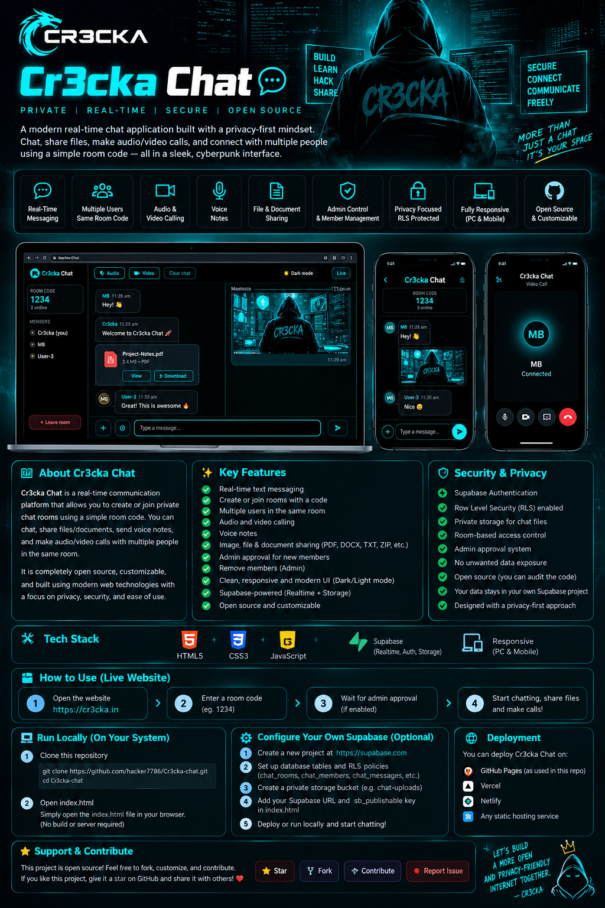

<div align="center">

# ⚡ Cr3cka Chat

### Real-Time Communication • Privacy-Focused Design • Cyberpunk UI

**A modern chat application to connect, communicate, and share — all through a simple room code.**

[](https://cr3cka.in)
[](https://github.com/hacker7786/Cr3cka-chat)
[](LICENSE)

<br>

<!-- Upload the project banner to assets/cr3cka-chat-banner.png -->


</div>

---

## ❤️ About Cr3cka Chat ❤️

**Cr3cka Chat** is a browser-based real-time communication project built with a privacy-conscious approach and a sleek black-and-neon-cyan interface.

Users can join a shared room using the same room code, communicate with other members, share supported media, and use audio/video calling features.

The project combines modern web technologies with Supabase backend services to create a simple and responsive communication experience.

> **Build. Connect. Communicate. Keep improving.**

## ✨ Key Features

| Feature | Description |
|---|---|
| 💬 Real-Time Messaging | Send and receive messages in shared rooms. |
| 🔑 Room Codes | Multiple people can join the same room using its code. |
| 🛡️ Admin Controls | Join-request approval and member management when configured. |
| 🎙️ Voice Notes | Record and share voice messages in supported browsers. |
| 🖼️ Image Sharing | Share supported images in chat. |
| 📎 Document Sharing | Share supported documents when enabled in the deployed version. |
| 📞 Audio Calling | Communicate using browser audio capabilities. |
| 🎥 Video Calling | Video communication using WebRTC. |
| 😀 Emoji Reactions | React to messages where enabled. |
| 📱 Responsive UI | Designed for desktop and mobile screens. |
| 🌗 Theme Toggle | Switch between dark and light themes. |
| ☁️ Supabase Integration | Backend services, database and file storage. |

## 🛠️ Tech Stack

- **HTML5** — Application structure
- **CSS3** — Responsive layout and neon styling
- **JavaScript** — Client-side functionality
- **Supabase** — Backend, database and Storage
- **WebRTC** — Browser-based audio/video communication
- **GitHub Pages** — Static website hosting

## 🌐 Try the Live Website

👉 **Live Demo:** https://cr3cka.in

### How to Use

1. Open the website in a modern browser.
2. Enter your username.
3. Enter a room code.
4. Share the same room code with the people you want to connect with.
5. If admin approval is enabled, wait for approval to join.
6. Start chatting and use the available sharing and calling features.
7. Allow microphone and camera permissions when prompted for calls.

🔐 **Tip:** Keep your room code private and share it only with intended participants.

## 💻 Run Cr3cka Chat Locally

### Requirements

- Git
- A modern web browser
- A configured Supabase project

### Installation

Clone the repository:

```bash
git clone https://github.com/hacker7786/Cr3cka-chat.git
```

Open the project folder:

```bash
cd Cr3cka-chat
```

You can open `index.html` in a browser. Alternatively, use Python's local server:

```bash
python3 -m http.server 8000
```

Open this address in your browser:

```text
http://localhost:8000
```

**Note:** The application requires valid Supabase configuration, database tables, permissions and Storage policies. Cloning the repository alone does not configure the backend.

## ⚙️ Supabase Configuration

To create your own instance:

1. Create a project at [Supabase](https://supabase.com).
2. Configure the required database tables and SQL functions for your version.
3. Enable and verify Row Level Security (RLS) on exposed tables.
4. Configure room-membership and admin-authorization policies.
5. Create and configure the required Storage bucket, such as `Chat-Uploads`.
6. Keep the bucket private and configure appropriate Storage policies.
7. Add your own Supabase project URL and publishable key to the existing configuration in `index.html`.

Example configuration — use your own values and match the variable names in your file:

```javascript
const SUPABASE_URL = "https://YOUR_PROJECT_ID.supabase.co";
const SUPABASE_PUBLISHABLE_KEY = "sb_publishable_YOUR_PUBLIC_KEY";
```

Do not add duplicate configuration variables if your existing code already defines them.

## 🔐 Security & Privacy

Security depends on correct backend configuration, not just the frontend design.

- A Supabase publishable key is intended for browser-side use.
- **Never expose** a Supabase secret key or `service_role` key in frontend code.
- Enable and test RLS policies on database tables.
- Restrict file access through private Storage buckets and appropriate policies.
- Enforce admin permissions in trusted database functions or backend logic.
- Use limited-lifetime signed URLs for private files.
- Keep room codes private.
- Test permissions using separate accounts before using sensitive data.
- Review Supabase Security Advisor for potential issues.

**Important:** Room codes and access controls do not automatically provide end-to-end encryption. No application should claim zero data leaks or complete security without appropriate testing and independent verification.

## 🚀 Deployment

Cr3cka Chat can be hosted on static hosting platforms, provided its Supabase backend is configured correctly.

- **GitHub Pages**
- **cloudflare**
- **Netlify**
- Other static hosting providers

After deployment, test messaging, room access, admin controls, Storage permissions, and audio/video calling.

## 📁 Project Structure

```text
Cr3cka-chat/
├── index.html
├── robots.txt
├── sitemap.xml
├── CNAME
├── google4b63fed60c66d744.html
├── favicon.png
├── .nojekyll
├── README.md
├── LICENSE
└── assets/
    └── cr3cka-chat-banner.png
```

Upload the banner image to `assets/cr3cka-chat-banner.png` for it to appear at the top of this README. If you choose a different path, update the image link above.

## 🤝 Contributing

Contributions, suggestions, bug reports and improvements are welcome!

1. Fork this repository.
2. Create a feature branch.
3. Make your changes.
4. Test your changes.
5. Submit a pull request describing your improvement.

Please do not include secrets, private keys or personal data in commits and issues.

## 🐛 Report an Issue

Found a bug or have a suggestion?

👉 [Open an issue on GitHub](https://github.com/hacker7786/Cr3cka-chat/issues)

Please include the steps to reproduce the issue, expected behavior, actual behavior and relevant browser information. Never include private credentials.

## ⭐ Support the Project

If you like Cr3cka Chat:

- ⭐ Star the repository.
- 🍴 Fork and experiment with the code.
- 💡 Suggest new features.
- 🛠️ Contribute improvements.
- 📢 Share the project with others.

---

<div align="center">

### 🖤 Built to Learn. Made to Connect.

**Cr3cka Chat — More Than Just a Chat.**

[🌐 Live Website](https://cr3cka.in) · [💻 GitHub Repository](https://github.com/hacker7786/Cr3cka-chat)

</div>

